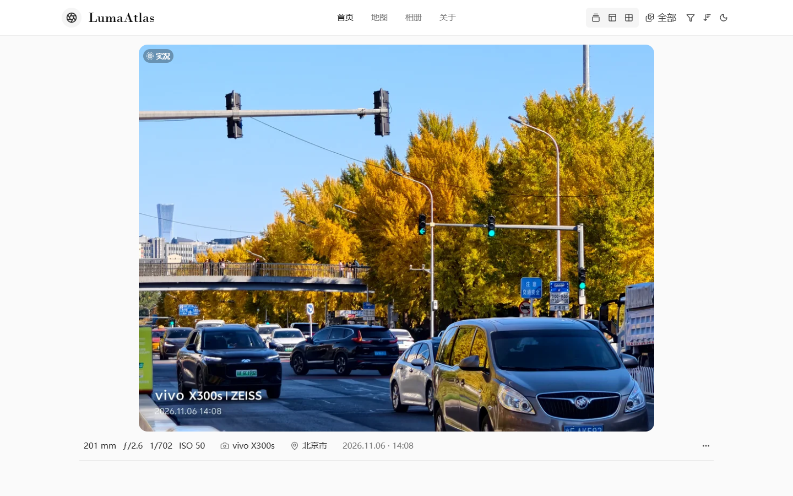

# LumaAtlas

一个以照片为中心的自托管影像网站。用大图、瀑布流或方格展示作品，也可以沿着地图与相册重新浏览它们；上传、整理和网站外观由后台管理。

[在线预览](https://photo.kun.ee/) · [部署与备份](DEPLOYMENT.zh-CN.md) · [MIT License](LICENSE)



上图截自 LumaAtlas 的公开站点。照片、站点名称和作者信息由站点管理员设置，并非安装后的预置内容。

## 可以做什么

**访客浏览**

- 在首页切换大图、瀑布流和方格；列数只影响当前浏览器，不改动全站设置。
- 按精选、最新、随机及距离等方式浏览，结合筛选、排序和颜色主题找到照片。
- 在地图上查看带有效坐标的照片，或按相册浏览；照片详情保留拍摄参数等信息。
- 可选展示作者介绍、关于页和页脚备案信息。

**站点管理**

- 批量上传照片，也可从公开图片直链导入到当前存储；管理公开状态、相册与封面。
- 解析 EXIF、生成缩略图，并通过任务队列处理照片与地理信息。
- 在后台修改网站信息、首页布局与显示内容、地图和存储配置。
- 支持本地目录、S3 兼容存储与 OpenList；支持后台备份与恢复。

照片是否能显示位置取决于原图中是否存在有效 GPS 坐标；地点名称还取决于逆地理编码服务是否可用。MapLibre 是地图渲染库，所选底图服务可能另有使用条款或费用。

## 快速部署

推荐 Docker Engine 24+ 与 Docker Compose v2。以下命令在 Linux 服务器上执行：

```bash
git clone https://github.com/zzkuner/LumaAtlas.git
cd LumaAtlas
cp .env.example .env
mkdir -p data
sudo chown -R 10001:10001 data
```

至少在 `.env` 中设置站点地址、长期保留的会话密钥和存储位置。例如使用本地存储：

```dotenv
NUXT_PUBLIC_SITE_URL=https://photos.example.com
NUXT_SESSION_PASSWORD=请替换为至少32位的随机字符串
NUXT_STORAGE_PROVIDER=local
NUXT_PROVIDER_LOCAL_PATH=./data/storage
NUXT_PROVIDER_LOCAL_BASE_URL=/storage
```

不要将真实 `.env` 提交到 Git。若在 `.env` 中预设管理员密码，务必改成强密码，不要使用示例默认值。首次打开网站时，按页面向导创建管理员并设置站点、存储和地图。

```bash
docker compose up -d --build
docker compose ps
curl http://127.0.0.1:3000/api/health
```

Compose 默认只监听服务器本机的 `127.0.0.1:3000`，请通过 HTTPS 反向代理对外提供服务。修改 `.env` 中的会话密钥会使现有登录失效，还可能影响已配置的两步验证。完整的反向代理、升级、备份与回滚说明见 [部署文档](DEPLOYMENT.zh-CN.md)。

## 数据与更新

`./data` 是持久化目录，包含数据库、本地照片、日志和备份；`.env` 单独保存部署密钥。升级前请备份两者，更新镜像时不要删除数据卷。

推送到 `main` 会触发 GitHub Actions 构建 Linux 镜像，并发布到 `server-latest`。**镜像发布不会自动替换你服务器上的容器**；自建服务器仍需自行拉取、校验并重启服务。

## 本地开发

项目使用 Nuxt 4、Vue 3、TypeScript、Tailwind CSS、Drizzle ORM 和 SQLite。CI 使用 Node.js 22 与 pnpm 11.25.0。

```bash
pnpm install --frozen-lockfile
pnpm build:deps
cp .env.example .env
pnpm dev
```

提交前可运行 `pnpm lint`、`pnpm typecheck`、`pnpm test` 和 `pnpm build`。

## 来源与许可

LumaAtlas 基于 [ChronoFrame](https://github.com/HoshinoSuzumi/chronoframe) 开发，保留其 MIT 许可与原作者 Timothy Yin 的版权声明。界面与功能设计也参考了 [CamLife](https://github.com/sun0225SUN/camlife)、[PicImpact](https://github.com/besscroft/PicImpact) 和 [Afilmory](https://github.com/Afilmory/Afilmory) 的思路；各项目的代码及素材仍遵循各自许可。详见 [LICENSE](LICENSE)。
